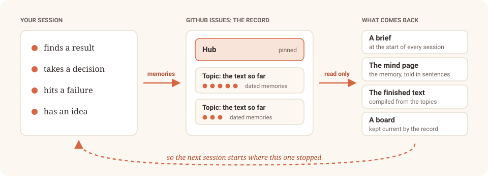
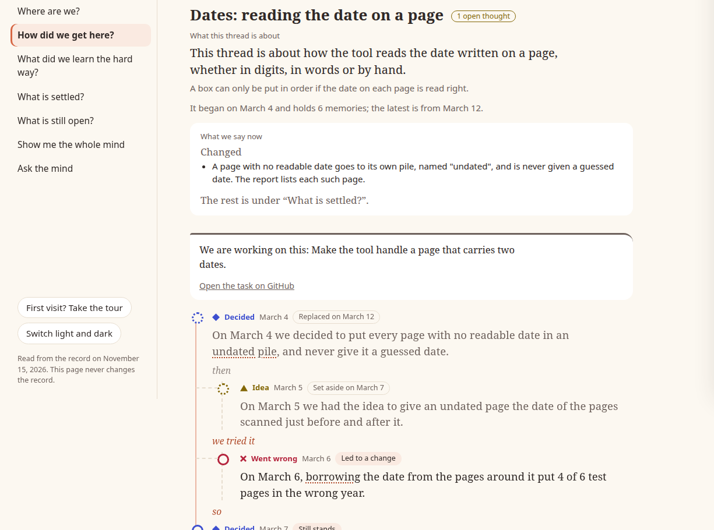
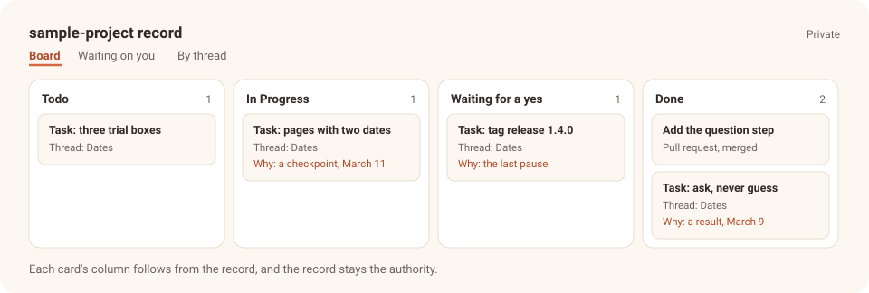

<p align="center">
  <picture>
    <source media="(prefers-color-scheme: dark)" srcset="assets/recortex-lockup-reversed.svg">
    
  </picture>
</p>

<p align="center">Project memory that survives every session.</p>

recortex is a Claude Code plugin. It keeps what a project knows in GitHub issues, not in a chat: what was found,
what was decided and why, what failed, and the current text of the paper, release notes or report. A new session, or
one whose context was compacted, starts from that record.

<picture>
  <source media="(prefers-color-scheme: dark)" srcset="assets/how-it-works-dark.svg">
  
</picture>

## What you get

- A session that starts where the last one stopped. A short brief of the record opens every session and every subagent.
- A record you can read on GitHub. One pinned hub, one issue per topic, and a dated memory for each result, decision, failure, idea and question.
- The mind page. One private local page that tells the memory in sentences: where things stand, how each thread got there, what went wrong, what is settled, what is open.
- The finished work, compiled. Topic bodies hold the deliverable's current text, so the paper or the release notes are assembled from the issues.
- Helpers that know your field. A short field sheet tells every subagent what counts as proof in your work and what must never be written down.
- A board that keeps itself current. Sub-issues and a private GitHub Projects board follow the record; you never drag a card to keep it honest.

## Quick start

You need Claude Code, the GitHub CLI `gh` (signed in) and Python 3.8 or newer.

1. Install the plugin.

   ```bash
   claude plugin marketplace add mr-eyes/recortex
   claude plugin install recortex@mr-eyes-skills
   ```

2. Trust your repository. The plugin shows a session nothing from GitHub until you do.

   ```bash
   mkdir -p ~/.config/recortex
   echo "your-name/your-project" >> ~/.config/recortex/trusted-repos
   ```

3. Open Claude Code in your project and say: "Set up the record for this project." You answer a few multiple-choice questions and confirm a summary. Nothing is written before that.

4. Work. Memories are posted as things happen. Say "pause here" when you stop, and "show me the mind of this project" when you want to read it back.

Already months into a project? Say "catch up the record". Coming from another tracker? Say "migrate the issues of owner/old-tracker". Both are in [Starting from existing work](docs/existing-work.md).

## A short story

An invented project sorts a box of scanned letters by the date written on each page. This is one of its threads, the way the mind page tells it.

<picture>
  <source media="(prefers-color-scheme: dark)" srcset="assets/mind-story-dark.png">
  
</picture>

> On March 4 we decided to put every page with no readable date in an undated pile, and never give it a guessed date.
>
> *then*
>
> On March 5 we had the idea to give an undated page the date of the pages scanned just before and after it.
>
> *we tried it*
>
> On March 6, borrowing the date from the pages around it put 4 of 6 test pages in the wrong year.
>
> *so*
>
> On March 7 we decided to show each undated page to the person and ask for its date, and stop borrowing dates from other pages.
>
> *so*
>
> On March 10 we asked whether asking still works when a box has a hundred undated pages and not twelve. Still open.

Each sentence is one comment on a GitHub issue. The words between them are links the session recorded: this failure tested that idea, this decision came from that failure. Three weeks later a new session opens, and its first lines are, abridged:

```text
recortex record brief for octo-org/sample-project (from the local index synced 2026-03-31T16:02:11Z (UTC), 2 minutes old).
Open active issues: 1
- #7 Task: pages that carry two dates
**Current focus:** Release 1.4.0, which reads dates written by hand. Pages that carry two dates are what is left.
**Holds:** The project owner says when 1.4.0 is tagged; until then, no tag.
```

Before it writes about the undated pages, it reads that thread: the failure and the decision it caused. It does not try the borrowed dates again. The failure is in the record.

## The board

<picture>
  <source media="(prefers-color-scheme: dark)" srcset="assets/board-dark.svg">
  
</picture>

Optional, chosen at setup, and private. The record decides which column a card is in, and the board is brought up to date at each pause. If you move a card by hand, the session asks what the move means before it changes anything, then records your answer or puts the card back.

## Read more

| If you want to | Read |
|---|---|
| See how the issues are laid out | [How the record works](docs/how-it-works.md) |
| Install as a plain skill, trust a shared repository, upgrade from before 0.5.0 | [Install and upgrade](docs/install.md) |
| Start from months of work or an older tracker | [Starting from existing work](docs/existing-work.md) |
| Know what the plugin will and will not do with untrusted text | [Safety and security](docs/security.md) |
| Look up a script, a hook or an agent | [Reference](docs/reference.md) |
| Change the plugin | [CONTRIBUTING.md](CONTRIBUTING.md) |

## License

MIT. See [LICENSE](LICENSE).
