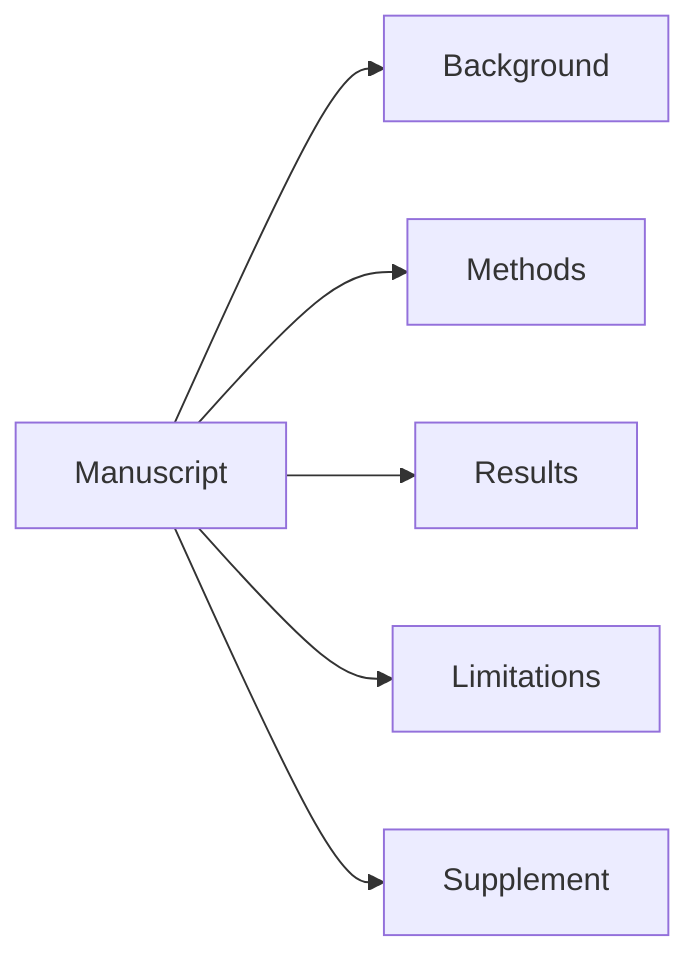

## Deliverable text

The body of every issue that carries a deliverable-section label is the text for that section of the deliverable: the current version only, in the deliverable's voice, ready to copy. Whoever assembles the deliverable reads those bodies and nothing else. Changing what the deliverable says is an edit of the body; a result that leaves the deliverable leaves the body, and the section label comes off with it. Comments are the history (dated results, decisions with the decider's words, failures and corrections) and never deliverable text. Work in development lives in issues labeled `active`, which carry no section labels; its result enters a body once it is adopted.

## Resume here

The current resume block is the newest comment on this issue that carries the resume markers and was posted by an account the reader has allowed, as found by `resume_block.py show` from the recortex skill. A comment headed "Resume block" from anyone else is not it. A new one is posted at the end of every working stretch; resume comments are never edited, and the older ones stay as history.

## Project

A two-season field trial of a winter rye cover crop and its effect on topsoil moisture.
Decisions are made by the principal investigator.

Times in this tracker are US Eastern time, written as 2026-11-16 10:10 EST. Times copied from GitHub or other tools in UTC are converted before they are written here.

## Map

## Deliverable sections

The issues whose bodies make up each section, sections in the order of each deliverable. Numbers are not repeated here; they live in the bodies, each with its source.

### Manuscript

| Section | Issue | What its body covers |
|---|---|---|
| Background | none yet | `ms:background` |
| Methods | none yet | `ms:methods` |
| Results | none yet | `ms:results` |
| Limitations | none yet | `ms:limitations` |
| Supplement | none yet | `ms:supplement` |

## Active issues

| Issue | Work in development | Destination topic |
|---|---|---|
| None yet | | |

## Pull requests

| Pull request | Merged | What it changed | Topic |
|---|---|---|---|
| None yet | | | |

## Labels

| Label | Meaning |
|---|---|
| `hub` | This issue |
| `final-record` | Topic issue: the body is current deliverable text, the comments are its history |
| `active` | Work in development; names its destination topic; carries no section labels |
| `triage` | Opened by hand; not yet placed in the record |
| `type:` labels | What an issue opened by hand is: task, bug, question, docs, idea, data, decision needed, duplicate, out of scope |
| `ms:background`, `ms:methods`, `ms:results`, `ms:limitations`, `ms:supplement` | The body is manuscript text for that section |

## Older tracker

None. The record starts here.

## Recording rules

1. Every finished experiment, decision, failure and merged change becomes a dated comment on its topic issue, written from the comment templates.
2. A decision is quoted word for word with date, time and zone, in a decision comment.
3. Every number carries its denominator, is checked against its source before posting, and in a body has its file, table, commit or tag under "Sources".
4. When what the deliverable says changes, the topic's body is edited in place, with no folded old text, and the event comment that caused the change is posted. Section labels follow the body's headings.
5. Work in development gets an issue labeled `active` that names its destination topic.
6. Every issue and pull request is labeled when opened; an issue opened by hand is triaged.
7. References outside this repository are written as `owner/repo#N` or a full URL.
8. A new resume comment is posted on this issue at the end of every working stretch. Resume comments are never edited.
9. Secrets and tokens are never posted.
